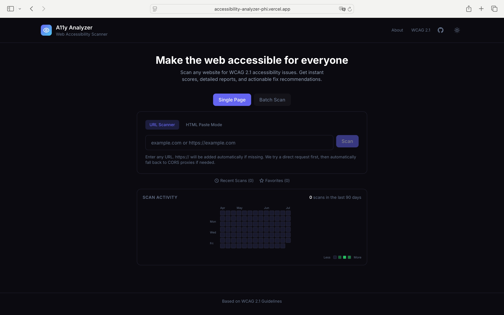
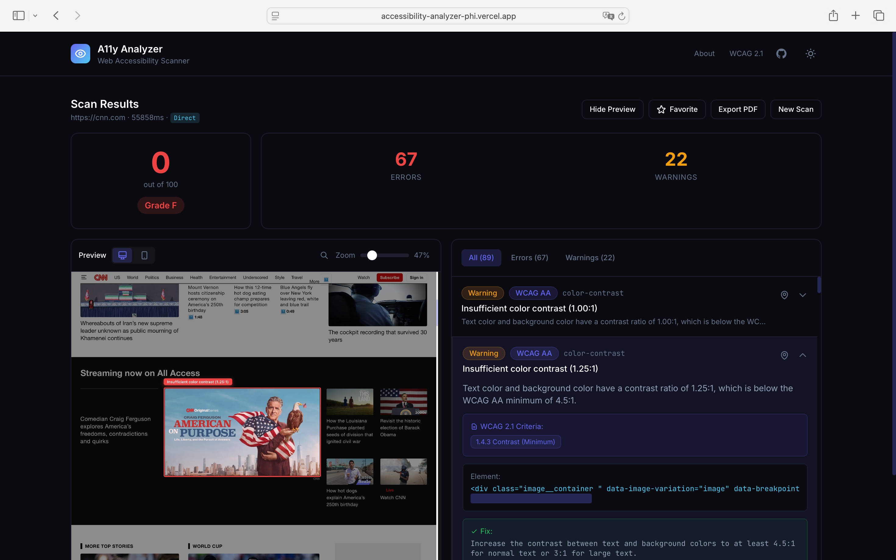
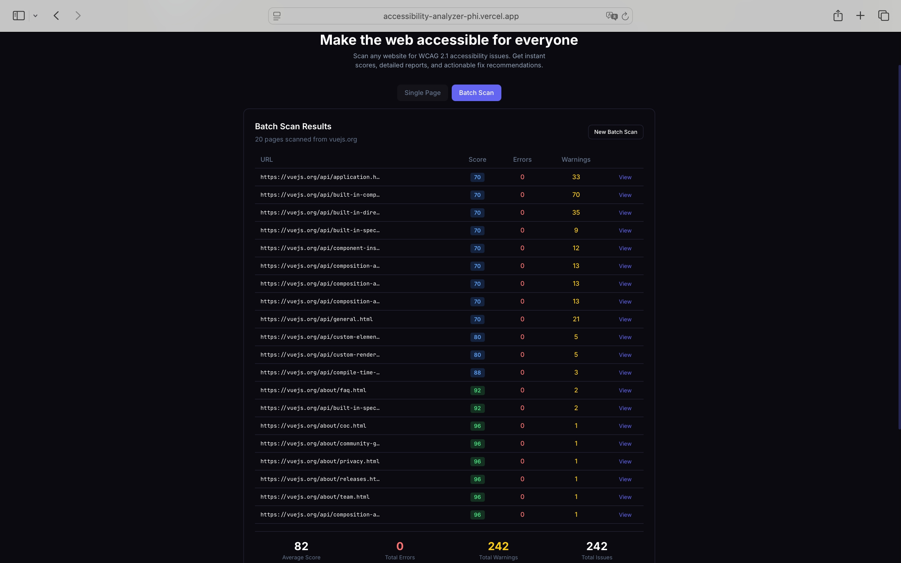
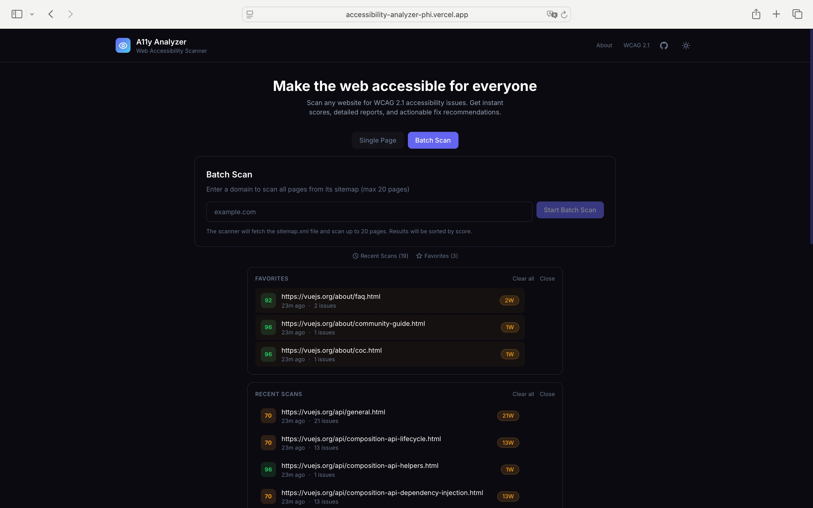

# AccessScan — 网页无障碍扫描器

> 让网络对每个人都可用。几秒内扫描任意网站的 WCAG 2.1 问题。

超过 16 亿人带有残障生活，而 96% 的网站不满足 WCAG 标准。AccessScan 帮开发者发现并修复这些问题——无需安装、无依赖，打开即扫。

**在线体验：** [accessibility-analyzer-phi.vercel.app](https://accessibility-analyzer-phi.vercel.app)

**[English](README.md)** | **中文**

---

## 目录

- [为什么无障碍很重要](#为什么无障碍很重要)
- [功能](#功能)
- [截图](#截图)
- [工作原理](#工作原理)
- [技术栈](#技术栈)
- [快速开始](#快速开始)
- [使用方法](#使用方法)
- [覆盖的 WCAG 规则](#覆盖的-wcag-规则)
- [项目结构](#项目结构)
- [许可](#许可)

---

## 为什么无障碍很重要

网页无障碍指构建人人可用的网站——包括视觉、运动、认知或听觉障碍人士。**WCAG 2.1** 标准（网页内容无障碍指南）定义了什么让网站可访问，但多数开发者从不检查。

AccessScan 让这个检查毫不费力。粘贴 URL，立即得到报告，在用户被排除之前修好问题。

---

## 功能

### 单页扫描

输入任意 URL，立即得到无障碍评分与详细问题分解。

- **20 条 WCAG 2.1 规则**，覆盖图片、表单、对比度、语义、ARIA 等
- **实时预览 + 点击高亮**——点击任意问题，直接在页面上看到对应元素
- **评分系统**——0-100 分 + A/AA/AAA 等级
- **导出 PDF**——一键生成含修复建议的可打印报告

### 批量扫描

一次扫描整个网站——单轮最多 20 个页面。

- **站点地图发现**——读取 `robots.txt`、常见 sitemap 路径，兜底用首页链接提取
- **多代理抓取**——4 种代理策略（self proxy、corsproxy.io、allorigins、codetabs）最大化可达性
- **排序结果表**——按评分排序，最差的排最前
- **点击查看**——跳转任意页面的完整报告与预览

### 扫描历史与收藏

- **最近扫描**——每次扫描本地保存，一键重扫
- **收藏**——标星重要扫描，快速访问
- **扫描活动热力图**——GitHub 风格的贡献图，展示 90 天扫描活动
- **URL 评分趋势**——追踪页面评分随时间的变化
- **独立存储**——清除最近扫描不影响活动、收藏或评分历史

### 问题高亮

点击报告中的任意问题，直接在实时预览中高亮问题元素。每个问题包含：

- 精确的 HTML 片段
- 人类可读的描述
- WCAG 标准引用（如 1.1.1 非文本内容）
- 带代码示例的具体修复建议

---

## 截图

### 首页（初始状态）



### 单页扫描结果



### 批量扫描结果



### 收藏与最近扫描



---

## 工作原理

```
用户输入 URL
       │
       ▼
┌─────────────────────────┐
│  7 层抓取策略            │
│  (直连 → self proxy →   │
│   corsproxy → allorigins│
│   → jina.ai → codetabs  │
│   → thingproxy)         │
└────────────┬────────────┘
             │ HTML 获取成功
             ▼
┌─────────────────────────┐
│  20 条 WCAG 2.1 规则    │
│  (基于 DOM 的评估)       │
└────────────┬────────────┘
             │ 发现的问题
             ▼
┌─────────────────────────┐
│  评分计算                │
│  + 问题报告              │
│  + 实时预览              │
│  + PDF 导出              │
└─────────────────────────┘
```

**抓取：** 扫描器先尝试直连请求，然后自动在最多 7 种代理策略间回退。即使站点有严格 CORS 策略也能可靠抓取。

**规则引擎：** 每条 WCAG 规则都是纯函数，接收解析后的 DOM `Document`，返回 `Issue` 对象数组。规则独立运行，单条规则出错不会阻塞其他规则。

**批量模式：** 多页扫描时，系统通过 `robots.txt` 的 Sitemap 指令、常见 sitemap 路径（`/sitemap.xml`、`/sitemap_index.xml` 等）发现 URL，最后兜底用首页链接提取。

---

## 技术栈

| 层 | 技术 | 为什么 |
|-------|-----------|-----|
| **框架** | React 18 + TypeScript | 类型安全 + 组件模型 |
| **样式** | Tailwind CSS | 快速 UI + 一致的设计 token |
| **构建** | Vite 5 | 快速开发服务器 + 优化的生产构建 |
| **部署** | Vercel（Serverless Functions） | 零配置托管 + API 代理 |
| **存储** | 浏览器 localStorage | 无需后端——数据全在本地 |
| **引擎** | 自研基于 DOM 的规则引擎 | 无重依赖，完全客户端运行 |

除 React 外**零运行时依赖**。无障碍引擎、评分系统、规则集全部手写——不用任何外部 a11y 库。

---

## 快速开始

### 前置条件

- Node.js 18+
- npm 或 pnpm

### 安装与运行

```bash
git clone https://github.com/Thomaszhou22/accessibility-analyzer.git
cd accessibility-analyzer
npm install
npm run dev
```

浏览器打开 `http://localhost:5000`。

### 生产构建

```bash
npm run build
npm run preview
```

### 部署到 Vercel

项目自带含 API 代理配置的 `vercel.json`。把 GitHub 仓库连接到 Vercel 即可自动部署。

---

## 使用方法

### 单页扫描

1. 选择**单页**模式
2. 输入 URL（如 `example.com`）
3. 按 **Enter** 或点击**扫描**
4. 查看评分、问题列表和实时预览
5. 点击任意问题在预览中高亮
6. 点击**导出 PDF** 生成可打印报告

### 批量扫描

1. 选择**批量扫描**模式
2. 输入域名（如 `web.dev`）
3. 按 **Enter** 或点击**开始批量扫描**
4. 等待 sitemap 发现 + 页面扫描
5. 查看结果表（按评分排序，最差在前）
6. 点击任意页面的**查看**看完整报告

### HTML 粘贴模式

适用于 JavaScript 渲染的页面或有机器人检测的网站：

1. 在浏览器打开目标页面
2. 按 `F12` → Elements → 右键 `<html>` → Copy outerHTML
3. 在 AccessScan 选择 **HTML 粘贴模式**
4. 粘贴 HTML，可选填来源 URL
5. 点击**扫描 HTML**

---

## 覆盖的 WCAG 规则

4 个 WCAG 原则类别下的 20 条规则：

| 类别 | 规则 ID | 检查什么 |
|----------|---------|---------------|
| **可感知** | `img-alt` | 图片缺少 `alt` 文本 |
| | `color-contrast` | 文字/背景对比度不足（< 4.5:1） |
| | `media-caption` | 音视频缺少字幕或文稿 |
| **可操作** | `tabindex` | `tabindex` 使用不当干扰导航 |
| | `accesskey` | 键盘快捷键冲突或缺失 |
| **可理解** | `html-lang` | `lang` 属性缺失或无效 |
| | `html-title` | 缺少 `<title>` 元素 |
| | `form-label` | 表单输入没有关联标签 |
| | `button-text` | 按钮无可访问文本 |
| | `link-text` | 链接无有意义文本 |
| | `empty-link` | `<a>` 标签无 href 或文本 |
| | `empty-heading` | 空标题元素 |
| | `heading-order` | 标题层级跳跃（如 h1 → h3） |
| | `lang-valid` | `lang` 属性中语言代码无效 |
| **健壮** | `duplicate-id` | 同页 `id` 重复 |
| | `aria-valid` | ARIA 属性或角色无效 |
| | `iframe-title` | `<iframe>` 缺少 `title` 属性 |
| | `meta-viewport` | viewport meta 阻止用户缩放 |
| | `list-structure` | 列表标记不当（`<ul>`/`<ol>` 无 `<li>`） |
| | `table-scope` | 表格中 `scope` 属性误用 |

---

## 项目结构

```
accessibility-analyzer/
├── api/
│   └── proxy.ts              # Vercel serverless 代理（绕过 CORS）
├── src/
│   ├── engine/
│   │   ├── rules.ts          # 20 条 WCAG 2.1 检测规则
│   │   ├── scanner.ts        # 多策略抓取器 + 评分引擎
│   │   └── types.ts          # TypeScript 类型定义
│   ├── lib/
│   │   ├── sitemap.ts        # Sitemap 发现 + 链接提取
│   │   └── storage.ts        # localStorage 持久层
│   ├── components/
│   │   ├── BatchScan.tsx     # 批量扫描 UI + 进度
│   │   ├── Favorites.tsx     # 收藏面板
│   │   ├── IssueList.tsx     # 问题列表（带筛选）
│   │   ├── PreviewPanel.tsx  # 实时预览 + 高亮覆盖层
│   │   ├── ScanHistory.tsx   # 最近扫描面板
│   │   ├── ScanInput.tsx     # URL 输入 + 模式切换
│   │   ├── ScorePanel.tsx    # 评分仪表 + 等级显示
│   │   ├── TrendChart.tsx    # GitHub 风格活动热力图
│   │   ├── UrlScoreHistory.tsx # 单 URL 评分趋势图
│   │   └── ui/               # 可复用 UI 原件（Button、Card 等）
│   ├── App.tsx               # 主应用 + 状态编排
│   └── index.css             # Tailwind + 全局样式
├── vercel.json               # Vercel 配置 + API 重写
├── vite.config.ts            # Vite 构建配置
└── package.json
```

---

## 许可

MIT 许可证——详见 [LICENSE](./LICENSE)。

---

> 我们相信：网络应该对每个人都可用。
